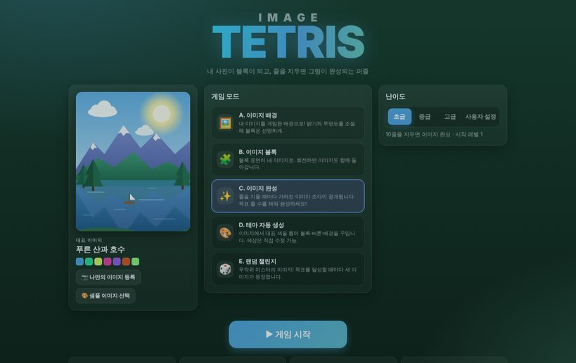
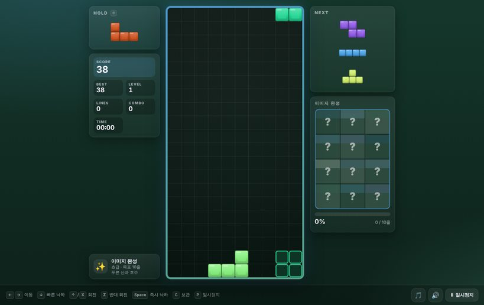
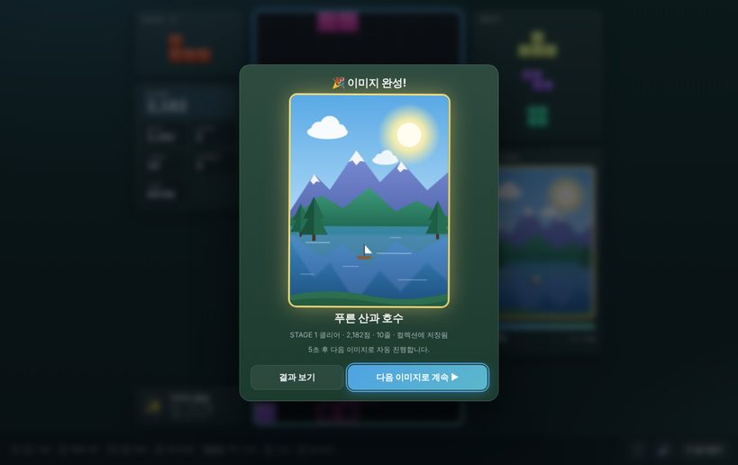
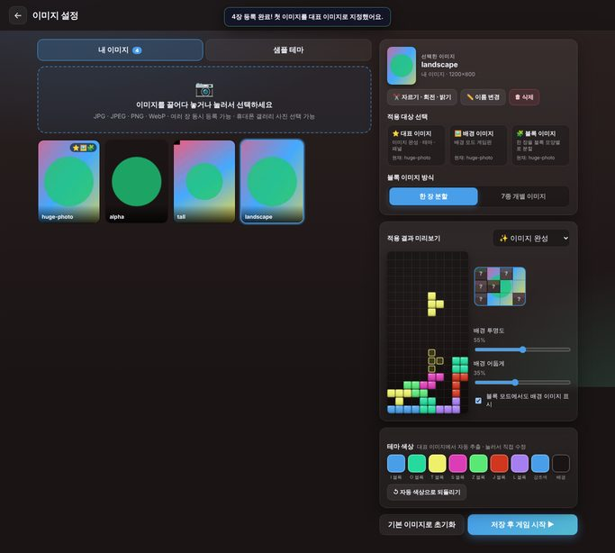
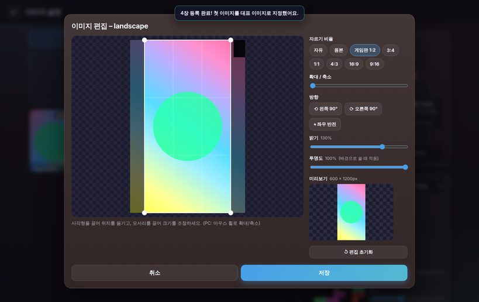
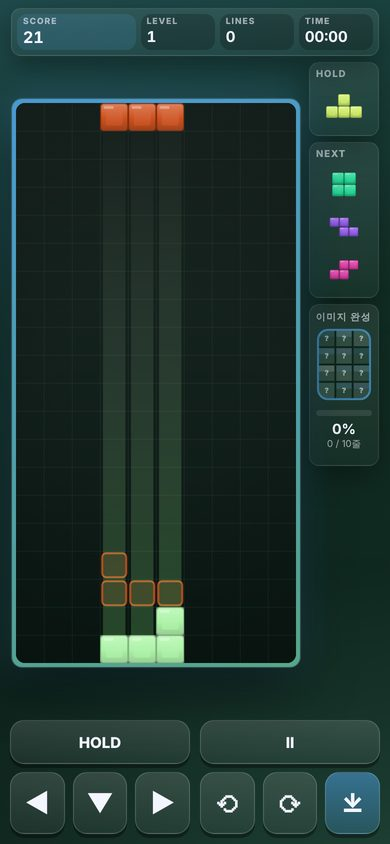

# IMAGE TETRIS – 나만의 이미지 블록 퍼즐 게임

내 사진으로 게임판 배경·블록·테마를 꾸미고, 줄을 지울 때마다 가려진 그림이 한 조각씩 드러나는 테트리스형 웹 게임입니다.
HTML5 · CSS3 · JavaScript(Canvas)만 사용하며 **서버·유료 API·외부 파일 없이** 브라우저에서 바로 실행됩니다.
등록한 사진은 기기 밖으로 전송되지 않고 브라우저(IndexedDB)에만 저장됩니다.

| 메인 | 이미지 완성 모드 | 이미지 완성! |
|---|---|---|
|  |  |  |
| **이미지 설정** | **이미지 편집기** | **모바일** |
|  |  |  |

---

## 1. 실행 방법

| 방법 | 설명 |
|---|---|
| **파일 하나로 실행** | `dist/image-tetris.html` 을 더블클릭 (모든 코드가 한 파일에 포함, 공유·전송용) |
| 소스 폴더로 실행 | `index.html` 을 더블클릭 (file:// 로도 동작 – ES 모듈을 쓰지 않음) |
| 로컬 서버 | `python3 -m http.server 8080` → http://localhost:8080 (휴대폰에서 같은 와이파이로 접속 가능) |

- 지원: 최신 Chrome / Edge / Safari / Firefox, Android·iOS 브라우저, 태블릿
- 단일 파일 다시 만들기: `node tools/build-single.js`

## 2. 조작 방법

| PC 키보드 | 동작 | 모바일·태블릿 |
|---|---|---|
| ← → | 좌우 이동 (누르고 있으면 자동 반복) | ◀ ▶ 버튼 / 좌우로 드래그 |
| ↓ | 빠른 낙하 | ▼ 버튼(누르고 있기) / 아래로 천천히 드래그 |
| ↑ 또는 X | 시계 방향 회전 | ⟳ 버튼 / 게임판 탭 |
| Z (또는 Ctrl) | 반시계 방향 회전 | ⟲ 버튼 |
| Space | 즉시 낙하 | ⤓ 버튼 / 아래로 빠르게 튕기기 |
| C (또는 Shift) | 블록 보관(HOLD) | HOLD 버튼 / 위로 튕기기 |
| P (또는 Esc) | 일시정지 | Ⅱ 버튼 |

터치 버튼과 스와이프는 서로 다른 영역에서 Pointer Events 로만 처리해 중복 입력이 생기지 않습니다.
DAS(자동 반복 시작)·ARR(반복 간격)·빠른 낙하 속도는 환경 설정에서 바꿀 수 있습니다.

## 3. 게임 모드

| 모드 | 내용 |
|---|---|
| **A. 이미지 배경** | 선택한 이미지를 비율 왜곡 없이(cover) 게임판 배경으로. 투명도·어둡게 조절로 블록은 선명하게 |
| **B. 이미지 블록** | 블록 표면에 이미지 적용. ① 한 장을 블록 모양별 영역으로 분할 ② 7종 블록에 각각 다른 이미지. 회전 시 이미지도 함께 90° 회전, 블록 색 테두리로 구분, 충돌 규칙은 그대로 |
| **C. 이미지 완성** | 이미지를 조각으로 가린 뒤, 줄을 지울 때마다 조각 공개(2·3·4줄 동시 제거 시 그만큼 증가). 진행률 % 표시, 목표 달성 시 축하 효과·효과음 → 컬렉션 저장 → 다음 이미지로 자동 진행 |
| **D. 테마 자동 생성** | 이미지에서 대표 색 7개 추출(k-means) → 블록·버튼·배경·테두리에 적용. 비슷한 색은 명도·색상을 자동 보정(ΔE 기준). 이미지 설정 화면에서 색을 직접 수정 가능 |
| **E. 랜덤 챌린지** | 등록 이미지+샘플 중 무작위 미스터리 이미지. 목표 달성마다 새 이미지(다음 이미지는 ‘?’로 숨김), 한 바퀴 돌 때까지 중복 없음, 완료 이미지는 컬렉션에 추가 |

난이도: **초급** 10줄(시작 레벨 1) · **중급** 20줄(레벨 3) · **고급** 40줄(레벨 5) · **사용자 설정** 목표 줄 수(1~200)·시작 레벨 직접 지정

기본 규칙: 10×20 보드, 7-bag, SRS 회전 + 월킥, 고스트, NEXT 3개, HOLD, 락 딜레이 0.5초(이동 리셋 15회),
가이드라인 점수(싱글 100 · 더블 300 · 트리플 500 · 테트리스 800 · T-Spin/Mini · Back-to-Back ×1.5 · 콤보 50×n · 퍼펙트 클리어) × 레벨, 10줄마다 레벨 업.

## 4. 이미지 등록 · 편집

- **메인 → 나만의 이미지 등록** (또는 이미지 설정 화면) → 사진을 끌어다 놓거나 눌러서 선택 (여러 장 동시, 휴대폰 갤러리 가능)
- 지원 형식: JPG · JPEG · PNG · WebP (최대 50MB). 손상된 파일·지원하지 않는 형식은 이유와 함께 안내
- 긴 변이 2048px 보다 큰 사진은 자동 축소해 저장(게임 속도 유지). 작은 사진은 원본 그대로 저장
- **자르기·회전·밝기**: 비율(자유/원본/게임판 1:2/3:4/1:1/4:3/16:9/9:16), 확대·축소(휠·슬라이더), 드래그로 위치 이동, 90° 회전, 좌우 반전, 밝기, 투명도 – 실시간 미리보기. 원본은 그대로 두는 **비파괴 편집**
- **적용 대상**: ⭐ 대표 이미지(완성·테마·패널) / 🖼️ 배경 / 🧩 블록(한 장 분할) / 블록 7종 개별 지정
- 적용 결과는 실제 게임 렌더러로 미리보기, ‘기본 이미지로 초기화’로 언제든 되돌리기
- 마지막으로 사용한 이미지와 설정은 자동 저장되어 다음 실행 때 그대로 이어집니다

## 5. 샘플 이미지 (26장, 6테마)

첫 실행에도 바로 즐길 수 있도록 **이 게임을 위해 코드(SVG)로 직접 그린 오리지널 일러스트**를 제공합니다.
(요청에 첨부 이미지가 포함되어 있지 않아 모두 자체 제작했습니다. 외부 이미지 주소나 존재하지 않는 파일은 사용하지 않습니다.)

| 테마 | 이미지 |
|---|---|
| 🏞️ 자연 풍경 | 푸른 산과 호수, 가을 숲, 아름다운 해변, 별이 가득한 밤하늘 |
| 🐾 귀여운 동물 | 고양이, 강아지, 토끼, 판다, 다람쥐 |
| 🧸 클레이 애니메이션 | 귀여운 점토 캐릭터, 동화 속 마을, 작은 숲속 동물, 파스텔톤 판타지 세계 (점토 질감 필터) |
| 🚗 자동차 | 클래식 자동차, 스포츠카, 미래형 자동차, 오프로드 자동차 (특정 브랜드·모델 아님) |
| 🚀 우주 및 미래도시 | 지구와 달, 우주 행성, 미래 도시, 우주 탐사선 |
| 🍓 과일 및 음식 | 사과, 배, 딸기, 수박, 디저트 |

### 샘플 추가·교체 방법

샘플은 `js/samples/theme-*.js` 에 테마별로 분리되어 있고 `IT.Samples.register()` 로 등록합니다.

```js
// 예: js/samples/theme-my.js 를 만들고 index.html 의 샘플 스크립트 목록에 추가
IT.Samples.register({ key: 'my-theme', name: '우리 가족', icon: '👨‍👩‍👧' }, [
  { key: 'family-1', name: '여름 휴가', src: 'assets/samples/family-1.jpg' }, // 이미지 파일 (웹 서버로 실행할 때)
  { key: 'logo', name: '로고', svg: '<svg xmlns="http://www.w3.org/2000/svg" viewBox="0 0 600 800">…</svg>' }, // 인라인 SVG (file:// 에서도 동작)
]);
```

- `key` 는 전체 샘플에서 고유해야 하며, 이미지 id 는 `sample:<key>` 가 됩니다.
- 기본 대표 이미지는 `js/samples/registry.js` 의 `DEFAULT_ID` 로 바꿀 수 있습니다.
- 파일(`src`) 샘플은 브라우저 보안 정책상 `file://` 로 열면 색 추출이 막힐 수 있으므로 로컬 서버(위 실행 방법)로 실행하세요. 개인 사진은 샘플로 넣기보다 게임 안의 ‘이미지 등록’을 쓰는 것이 간편합니다.

## 6. 저장 데이터

| 데이터 | 저장 위치 |
|---|---|
| 등록 이미지(원본/최적화본, 썸네일, 편집값) | IndexedDB `image-tetris` › `images` |
| 완성 이미지 컬렉션(사본 1200px – 원본을 지워도 유지) | IndexedDB › `collection` |
| 모드별 최고 점수(Top 10), 플레이 횟수, 누적 줄·시간, 완성 수 | LocalStorage `imageTetris.records` |
| 사운드·조작·화면 설정, 난이도, 모드, 이미지 지정 | LocalStorage `imageTetris.settings` / `config` |
| 샘플 편집값, 이미지별 테마 색 수정 | LocalStorage `imageTetris.sampleAdjust` / `themeOverrides` |

환경 설정 › 데이터 관리에서 이미지 전체 삭제, 컬렉션 삭제, 기록 초기화, 모든 데이터 초기화를 할 수 있습니다.
IndexedDB 를 쓸 수 없는 환경(일부 사생활 보호 모드)에서는 메모리에 임시 저장하고 화면에 안내합니다.

## 7. 프로젝트 구조

게임 로직(엔진)·이미지 처리·렌더링·UI 가 분리되어 있어, 엔진은 Node.js 에서 단독 테스트되고 다른 렌더러/앱(예: Capacitor, React Native WebView)으로 옮기기 쉽습니다.

```
image-tetris/
├─ index.html              화면 구조 (메인/이미지 설정/게임/컬렉션/기록/설정)
├─ css/style.css           디자인 (CSS 변수 = 이미지 테마로 실시간 변경, 반응형)
├─ js/
│  ├─ util.js              공통 유틸 (색 변환, ΔE, 난수 등)
│  ├─ core/                ★ 순수 게임 로직 (DOM 없음)
│  │  ├─ pieces.js         테트로미노 · SRS 회전 상태 · 월킥 테이블 · 텍스처 좌표(u,v)
│  │  ├─ engine.js         보드, 7-bag, 이동/회전/낙하/락 딜레이, 줄 제거, 점수, T-Spin, 홀드, 이벤트
│  │  └─ modes.js          모드/난이도 정의, 이미지 공개 진행(RevealProgress), 중복 없는 무작위 선택기
│  ├─ image/               ★ 이미지 처리
│  │  ├─ processor.js      파일 검증·디코딩·고해상도 축소·썸네일·비파괴 편집 적용
│  │  ├─ palette.js        k-means 대표색 추출, 블록 7색 자동 보정, UI 테마 생성
│  │  └─ textures.js       이미지 블록 텍스처 (한 장 분할 / 7종 개별)
│  ├─ samples/             샘플 이미지 (registry.js + 테마별 파일, svg-kit.js 그리기 도구)
│  ├─ data/                IndexedDB(db.js), LocalStorage(storage.js), 이미지 라이브러리, 컬렉션
│  ├─ audio/sound.js       Web Audio 로 효과음 20종·오리지널 배경음 실시간 합성
│  ├─ render/              캔버스 렌더러(블록 스프라이트 캐시), 효과(파티클 등), 이미지 완성 패널
│  ├─ ui/                  입력(키보드 DAS/ARR·터치·스와이프), 모달/토스트, 편집기, 화면
│  ├─ game.js              게임 세션: 엔진+이미지+렌더러+입력+사운드+모드 규칙 연결
│  └─ main.js              앱 시작, 화면 전환, 테마 적용, 반응형 레이아웃 계산
├─ tests/
│  ├─ engine.test.js       순수 로직 단위 테스트 39개 (node 로 실행)
│  └─ e2e.test.js          브라우저 통합 테스트 22개 (Playwright + Chromium)
├─ tools/build-single.js   단일 HTML 빌드
└─ dist/image-tetris.html  빌드 결과 (파일 하나로 실행)
```

확장 포인트 예: 새 모드는 `core/modes.js` 의 `MODES` 에 추가하고 `game.js` 의 `_loadStage`/`_onClear` 에 규칙을 넣으면 됩니다.
엔진 이벤트(`spawn, move, rotate, harddrop, lock, clear, levelup, hold, gameover`)만 구독하면 다른 UI 로도 재사용할 수 있습니다.

## 8. 테스트

```bash
node tests/engine.test.js     # 단위 테스트 (의존성 없음)
node tests/e2e.test.js        # 브라우저 테스트 (playwright 필요, 스크린샷은 tests/screenshots/)
```

### 결과 (2026-11-24, Linux · Node 22 · Headless Chromium)

**단위 테스트 39 / 39 통과** – SRS 회전 상태·월킥, 텍스처 좌표 유지, 7-bag 분포(70개 중 각 10개), 벽/블록 충돌, I·T 월킥,
하드/소프트 드롭 점수, 락 딜레이·이동 리셋 15회 제한, 중력 속도, 싱글/테트리스/B2B/콤보/퍼펙트 클리어 점수, T-Spin Double 판정,
레벨 업, 홀드 규칙, 일시정지, 게임 오버, 10만 프레임 무작위 플레이 안정성, 공개 진행률(1·2·3·4줄, 목표 초과, 사용자 목표 격자),
무작위 선택기 중복 방지, 대표색 추출, 비슷한 색 자동 보정(ΔE ≥ 15).

**브라우저 통합 테스트 22 / 22 통과**

| 항목 | 결과 |
|---|---|
| 첫 실행 / 샘플 26장 래스터화·테마 추출 | 콘솔 오류 0, 26장 모두 성공 |
| 기본 조작 (키보드 이동·회전·홀드·하드드롭·DAS) | 통과 |
| 일시정지 중 진행 정지 → 재개 | 통과 |
| 줄 제거 ↔ 공개 진행률 일치 (1·2·3·4줄 누적 10줄) | 10%→30%→60%→100%, 조각 수 일치 |
| 이미지 완성 → 컬렉션 저장 → 다음 이미지 자동 진행 | 통과 (보드·진행률 초기화 확인) |
| 게임 오버 → 결과 화면 → 기록 저장 | 통과 |
| 다중 업로드 + 오류 처리 | 4000×3000 JPEG·투명 PNG·WebP·JPG 등록, 손상 JPG·GIF·TXT 거부 안내, 4000×3000 → 2048×1536 |
| 편집: 1:2 자르기 + 90° 회전 + 밝기 | 결과 400×800 (비율 정확) |
| 새로고침 후 저장 데이터 복구 | 이미지·편집값·설정·컬렉션 모두 복구 |
| 이미지 블록 회전 (텍스처 90° 회전 픽셀 비교) | 평균 오차 4.06/255 (테두리 하이라이트 영향) |
| A·D·E 모드 실행 / E 모드 다음 이미지 변경 | 통과 |
| 장시간 플레이 (30초 실시간 연속 입력, 이미지 블록 모드) | 평균 16.7ms/프레임(60fps), p95 16.7ms, JS 힙 10MB |
| 창 크기 변경 1366×860 · 1024×700 · 800×1100 · 1920×1080 · 600×900 | 모두 화면 안에 맞게 재배치, 가로 스크롤 없음 |
| 사운드 합성 (효과음 20종 + 배경음, 켜기/끄기) | 오류 없음 |
| 설정·기록·컬렉션·이미지 보기 화면 | 통과 |
| 이미지 삭제 시 지정 해제 / 기본 이미지로 초기화 | 통과 |
| 모바일 390×844 (터치 에뮬레이션): 화면 · 터치 버튼 · 스와이프 | 탭 1번=1동작(중복 없음), 드래그 2칸, 탭 회전, 튕기기 즉시 낙하 |
| 모바일 가로 844×390 · 태블릿 820×1180 | 통과 |

### 실행하지 못한 테스트 (직접 확인 필요)

- **실제 휴대폰·태블릿 기기**에서의 터치 감도와 체감 반응 속도 (에뮬레이션으로만 확인)
- **iOS Safari / 실제 Firefox·Safari 엔진** (Chromium 으로만 자동 테스트)
- **소리가 실제로 들리는지·음량 밸런스** (헤드리스 환경에는 스피커가 없어 오류 없이 합성되는지만 확인)
- **진동 피드백** (지원 기기 필요)
- 수십~수백 장 이상 대량 업로드 시의 저장 공간 한도 (브라우저마다 다름)
- 실사용 하드웨어(저사양 휴대폰)에서의 프레임 속도 – 시각 효과를 ‘간단하게’로 바꾸면 파티클 수가 1/3 로 줄어듭니다
